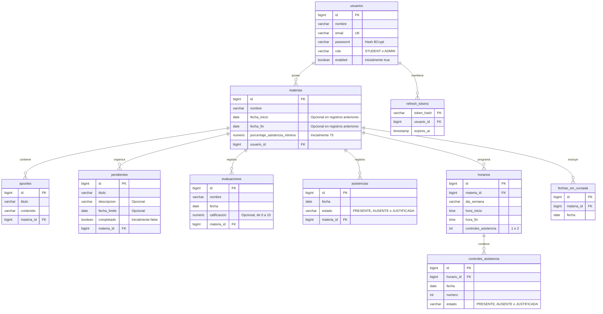

# Acadezer — Organizador académico personal

Backend pequeño para dos integrantes: Java 21, Spring Boot **4.0.6**, Maven Wrapper,
Spring MVC, Security, JPA, Jakarta Validation, BCrypt y JJWT 0.12.6. Cada estudiante
administra sus materias, apuntes de texto, pendientes, evaluaciones y asistencias.

## Diagrama entidad-relación (DER)

El diagrama representa las tablas de Neon y sus claves primarias (`PK`), foráneas
(`FK`) y únicas (`UK`). Un usuario puede tener varias materias; cada materia puede
tener varios apuntes, pendientes, evaluaciones y asistencias. Cada recurso pertenece
a una sola materia y, a través de ella, a un solo usuario.



En `asistencias`, la combinación **`materia_id` + `fecha` es única**. Los roles y
estados son enums almacenados como texto, sin tablas adicionales. La IA utiliza el
contenido de `apuntes`; las preguntas generadas no se guardan en la base de datos.
El rol ADMIN permite administrar cuentas y consultar estadísticas, sin cambiar
la propiedad ni el acceso privado a las materias y su contenido.

## Iniciar en desarrollo con Neon y Groq

Requisitos: JDK 21 y acceso a Internet para descargar dependencias en la primera
ejecución. Maven Wrapper está incluido. El perfil predeterminado es **local** y usa
el archivo existente `src/main/resources/application-local.properties`.

```powershell
.\mvnw.cmd clean verify
.\mvnw.cmd spring-boot:run
```

No hace falta volver a ingresar las credenciales que ya están en ese archivo.
La configuración local contiene `spring.datasource.url`, `spring.datasource.username`,
`spring.datasource.password`, `jwt.secret` y `spring.ai.openai.api-key`. Se conserva
la clave de Groq bajo ese nombre para aprovechar tu configuración existente; no
requiere Spring AI. La URL JDBC de Neon debe incluir `sslmode=require`.

Al clonar el repositorio en otra computadora, ese archivo privado no estará incluido.
Crear `src/main/resources/application-local.properties` con esta plantilla y completar
las credenciales de la base nueva por un canal privado:

```properties
spring.datasource.url=jdbc:postgresql://<host-neon>/<base>?sslmode=require
spring.datasource.username=<usuario>
spring.datasource.password=<contraseña>
jwt.secret=${JWT_SECRET}
spring.ai.openai.api-key=${AI_API_KEY:}
```

Para esa plantilla, generar `JWT_SECRET` antes de iniciar:

```powershell
$env:JWT_SECRET = [Convert]::ToBase64String([System.Security.Cryptography.RandomNumberGenerator]::GetBytes(32))
```

Para habilitar IA, configurar también `AI_API_KEY` con la clave de Groq. Usar una
clave JWT estable entre reinicios si se quieren conservar los tokens vigentes.

La API escucha en `http://localhost:8080`; CORS admite Angular en
`http://localhost:4200`. JPA usa **validate**: el arranque comprueba el esquema sin
modificarlo. Se comprobó que la nueva base Neon estaba vacía y se crearon sus tablas
académicas iniciales mediante `database/academic-postgres.sql`, sin DROP ni migración del ATS.
No hace falta volver a ejecutar el script en esa base.

El archivo local está ignorado por Git y **excluido del JAR**. Spring lo carga desde
el disco únicamente con el perfil `local`. Ejecutar desde la raíz del repositorio:

```powershell
java -jar target/acadezer-0.0.1-SNAPSHOT.jar
```

Para ejecutar el JAR fuera del repositorio, poner la configuración privada en
`./config/application-local.properties`, ubicación externa estándar de Spring Boot.
No copiarla dentro del artefacto ni versionarla.

### H2 opcional para desarrollo sin conexión

El perfil `dev` sigue disponible explícitamente; no carga las credenciales locales:

```powershell
$env:SPRING_PROFILES_ACTIVE = 'dev'
$env:JWT_SECRET = [Convert]::ToBase64String([System.Security.Cryptography.RandomNumberGenerator]::GetBytes(32))
.\mvnw.cmd spring-boot:run
```

Crea una H2 persistente separada en `./data/academico`, ignorada por Git, con
`ddl-auto=update`. Las pruebas usan el perfil `test`, H2 en memoria y una clave JWT
pública exclusiva de test. Nunca usan Neon ni el proveedor real de IA.

### Otra base PostgreSQL vacía

El script es manual, transaccional y solo crea tablas, restricciones e índices:

```powershell
createdb -U postgres academico_dev
psql -U postgres -d academico_dev -v ON_ERROR_STOP=1 -f database/academic-postgres.sql
$env:SPRING_PROFILES_ACTIVE = 'postgres'
$env:ACADEMIC_DB_URL = 'jdbc:postgresql://localhost:5432/academico_dev'
$env:ACADEMIC_DB_USERNAME = 'postgres'
$env:ACADEMIC_DB_PASSWORD = '<contraseña local>'
$env:JWT_SECRET = '<clave Base64 de al menos 32 bytes>'
.\mvnw.cmd spring-boot:run
```

El perfil `postgres` también usa `ddl-auto=validate`. No apuntar el script a la base
anterior del ATS ni ejecutarlo sobre tablas académicas existentes.

## Desplegar Acadezer en Render

El repositorio incluye [Dockerfile](Dockerfile), [.dockerignore](.dockerignore),
[render.yaml](render.yaml) y [.env.example](.env.example). Docker compila y ejecuta
las pruebas con Maven 3.9 y Java 21, y luego inicia el JAR con Java 21 JRE como un
usuario sin privilegios. El perfil del contenedor es `postgres`: no usa H2 ni carga
`application-local.properties`. El contexto de Docker excluye credenciales locales.

1. Subir estos cambios a la rama `main` del repositorio elegido.
2. En Render, crear **New > Web Service** y conectar ese repositorio.
3. Usar nombre `acadezer`, rama `main`, **Language: Docker** y Dockerfile `./Dockerfile`.
4. Configurar **Health Check Path: `/health`**. Dejar Docker Command sin completar:
   el Dockerfile ya contiene el comando de inicio.
5. En **Environment > Add from .env**, pegar las variables de despliegue.
6. Crear/desplegar el servicio y probar `https://<dominio-asignado-por-render>/health`.
   La respuesta esperada es `{"status":"UP"}`.

Si se prefiere crear un Blueprint, `render.yaml` contiene la misma configuración
y pide los secretos al crear el servicio. No contiene credenciales ni crea otra
base de datos: se sigue usando Neon. No crear ambos tipos de despliegue a la vez
para el mismo backend. Ver [Docker en Render](https://render.com/docs/docker) y
[variables de entorno](https://render.com/docs/configure-environment-variables).

La base de Neon debe tener aplicado [database/add-user-roles.sql](database/add-user-roles.sql)
si se creó con la versión anterior al administrador. El despliegue mantiene
`ddl-auto=validate`: no crea ni modifica tablas automáticamente.

La configuración lista para este entorno se dejó en **`.env.render`**, un archivo
privado ignorado por Git y Docker. Contiene los datos de Neon y Groq existentes,
una clave JWT aleatoria nueva para Render y el origen Angular local. No subirlo al
repositorio. Para otro integrante/entorno, completar `.env.example` por separado.
Cambiar `CORS_ORIGIN` por la URL exacta del frontend cuando Angular esté desplegado,
sin ruta ni barra final. `PORT` lo proporciona Render y el backend lo respeta.

`GET /health` es público y comprueba que el proceso HTTP responde; no consulta
datos privados, no verifica continuamente la conexión a Neon y no llama a Groq.
Las rutas académicas y administrativas siguen requiriendo autenticación.

`render.yaml` selecciona el plan gratuito. Render suspende un servicio gratuito
después de 15 minutos sin tráfico y lo reactiva al recibir otra solicitud; para
mantenerlo activo permanentemente hace falta un plan de pago. No se implementan
pings artificiales. Ver [limitaciones del plan gratuito](https://render.com/docs/free).

El servicio en Render debe crearse después de publicar estos archivos en GitHub.
Docker no está disponible en este equipo: la construcción de la imagen y el
arranque en Render quedan pendientes del despliegue. El JAR y el endpoint de salud
se comprueban con las pruebas locales.

## Variables de entorno

| Variable | Valor predeterminado / significado |
|---|---|
| `JWT_SECRET` | Obligatoria fuera de `local`; en `local` ya existe `jwt.secret` privado |
| `JWT_EXPIRATION_MS` | `3600000` (una hora) |
| `JWT_REFRESH_EXPIRATION_MS` | `604800000` (siete días), duración del refresh token |
| `REFRESH_COOKIE_SECURE` | `true`; solo usar `false` en desarrollo HTTP local |
| `PORT` | `8080` |
| `CORS_ORIGIN` | `http://localhost:4200`, orígenes explícitos separados por comas |
| `SPRING_PROFILES_ACTIVE` | Ausente: `local`; alternativas: `dev`, `postgres` |
| `ACADEMIC_DB_URL` | Obligatoria con `postgres`, URL JDBC de la base nueva |
| `ACADEMIC_DB_USERNAME` | Obligatoria con `postgres` |
| `ACADEMIC_DB_PASSWORD` | Obligatoria con `postgres` |
| `AI_API_KEY` | Si no existe, usa `spring.ai.openai.api-key` de la configuración local |
| `AI_MODEL` | `openai/gpt-oss-20b`; también admite `spring.ai.openai.chat.options.model` local |
| `AI_URL` | `https://api.groq.com/openai/v1/chat/completions` |
| `AI_TIMEOUT` | `20s`, tiempo máximo de la solicitud y de conexión |

La integración mantiene Groq como proveedor predeterminado y usa su API HTTP de
texto. Usa la clave local existente; `AI_API_KEY` y `AI_MODEL` permiten configurar
los valores por entorno. Se cambió el modelo anterior porque ya no aparecía en
la lista de modelos disponibles para esta cuenta. El contrato
sigue [Chat Completions](https://console.groq.com/docs/api-reference) y
[JSON Object Mode](https://console.groq.com/docs/structured-outputs); el servidor
valida además la estructura y la cantidad de preguntas. No hay SDK con reintentos,
agentes, RAG, vectores, herramientas ni historial. No se imprimen claves ni cuerpos
de error del proveedor. Nunca poner credenciales en archivos versionados. `.env`
está ignorado, pero Spring no lo carga automáticamente.

## Autenticación y contratos para Angular

Todos los cuerpos y respuestas usan JSON. Registro, login, refresh, logout y `GET /health` son públicos.
Para el resto enviar `Authorization: Bearer <accessToken>`.

### Límites de autenticación y de IA

Los controles son locales a cada proceso Java y están habilitados por defecto.
No requieren tablas nuevas ni modifican datos de Neon. Configuración por entorno:

| Variable | Predeterminado | Alcance |
|---|---|---|
| `LOGIN_ACCOUNT_LIMIT` | `10` | Intentos de login por email normalizado |
| `LOGIN_IP_LIMIT` | `100` | Solicitudes de login por IP |
| `LOGIN_LIMIT_WINDOW` | `15m` | Ventana de ambos límites de login |
| `REGISTER_ACCOUNT_LIMIT` | `5` | Intentos de registro por email normalizado |
| `REGISTER_IP_LIMIT` | `30` | Solicitudes de registro por IP |
| `REGISTER_LIMIT_WINDOW` | `1h` | Ventana de ambos límites de registro |
| `AI_USER_QUOTA` | `20` | Intentos admitidos de generación por usuario autenticado |
| `AI_QUOTA_WINDOW` | `1h` | Ventana de la cuota de IA |
| `AI_MAX_CONCURRENT` | `2` | Generaciones simultáneas por instancia |
| `AI_MAX_CONCURRENT_PER_USER` | `1` | Generaciones simultáneas de un usuario |
| `RATE_LIMIT_MAX_KEYS` | `10000` | Máximo de claves por contador en memoria (uno para autenticación y otro para IA) |
| `TRUSTED_PROXY_CIDRS` | Vacío | IPs o CIDRs de proxies confiables, separados por comas |

Los límites y las duraciones deben ser positivos. Las ventanas comienzan con el
primer intento de cada clave; no son ventanas móviles ni se alinean con la hora.
Los intentos rechazados no prolongan la ventana. Al vencerla se vuelve a permitir
el acceso, sin cambiar `enabled`, el rol ni la contraseña de la cuenta.

**Login y registro:** los contadores de ambos endpoints son independientes. La IP
se controla antes de leer/validar el JSON, por lo que también cuentan los cuerpos
malformados. Después de validar el request se controla el email, incluso si no
existe una cuenta. Las mayúsculas no permiten crear otro contador. Los intentos
exitosos y fallidos cuentan; un login exitoso no reinicia la protección. Al superar
cualquiera de los límites se devuelve 429, sin consultar credenciales ni ejecutar
el registro. Un límite de cuenta puede producir una denegación temporal para ese
email; no existe un bloqueo permanente o una penalización que crezca con los intentos.

**IA:** se verifica autenticación y propiedad del apunte antes de consultar la cuota.
Un apunte ajeno o inexistente mantiene su 404, aun si el usuario agotó la cuota.
La cuota es por usuario, compartida entre sus apuntes; no depende de un `usuarioId`
enviado por Angular. ADMIN también está sujeto a los límites cuando usa sus apuntes.
Una configuración de IA ausente o un contenido insuficiente detectado localmente
no consume cuota. Antes de llamar al proveedor se comprueban cuota y concurrencia,
sin esperar en una cola: si no hay cupo se devuelve 429 y no se llama a Groq.
Los rechazos por concurrencia no consumen cuota. Los intentos ya admitidos cuentan
incluso si Groq falla, devuelve contenido insuficiente o vence el timeout, para no
permitir llamadas costosas ilimitadas. El permiso de concurrencia se libera siempre
al terminar, también ante errores, interrupciones o timeout.

**IP y proxies:** `server.forward-headers-strategy=none` evita que Spring/Tomcat
reescriba la IP antes del control. Mantener ese valor. Por defecto se usa únicamente
la IP de la conexión y se ignoran todas las cabeceras de IP. Si esa IP pertenece a
`TRUSTED_PROXY_CIDRS`, se procesa `X-Forwarded-For` de derecha a izquierda, atravesando
solo proxies configurados y deteniéndose en la primera IP no confiable. Así se
ignoran prefijos falsificados. Cadenas inválidas o excesivas vuelven a la IP de la
conexión. `Forwarded`, `X-Real-IP` y `CF-Connecting-IP` no se utilizan.

En Render hay proxies delante de la aplicación: configurar únicamente sus IPs o
redes verificadas y los proxies intermedios controlados, sin adivinar rangos ni usar
`0.0.0.0/0` o `::/0` (la aplicación los rechaza). Si no se pueden verificar, mantener
la lista vacía: es seguro, pero los clientes que llegan por el mismo proxy comparten
el contador de IP. Ajustar los límites de IP a ese escenario. El contador por cuenta
sigue siendo independiente. Esta implementación no asume que cualquier cabecera
recibida en Render sea confiable. Referencias: [IpAddressMatcher de Spring Security](https://docs.spring.io/spring-security/reference/7.0/api/java/org/springframework/security/web/util/matcher/IpAddressMatcher.html)
y [seguridad de X-Forwarded-For](https://developer.mozilla.org/en-US/docs/Web/HTTP/Reference/Headers/X-Forwarded-For).

**Memoria y varias instancias:** contadores y permisos no se guardan en Neon. Un
reinicio, un despliegue o la suspensión/reactivación de Render reinician los límites.
Cada instancia tiene su propia cuota y concurrencia: con varias réplicas no existe
un límite global compartido. Esta solución está pensada para una sola instancia;
para coordinar varias se necesitaría un almacenamiento compartido, fuera de esta
entrega. Los mapas tienen capacidad máxima; al llenarse rechazan nuevas claves con
429 hasta que venzan entradas, sin expulsar contadores activos que permitan evadir
el límite. La limpieza de ventanas expiradas es bajo demanda.

#### Respuesta 429 para Angular

Los límites mantienen el mismo contrato JSON de errores y agregan una cabecera
`Retry-After` con segundos enteros positivos. CORS expone esa cabecera a Angular:

```http
HTTP/1.1 429 Too Many Requests
Content-Type: application/json
Retry-After: 60
Access-Control-Expose-Headers: Retry-After
```

```json
{"status":429,"message":"Se alcanzó el límite de solicitudes. Intentá nuevamente más tarde","path":"/api/apuntes/1/preguntas","timestamp":"2026-11-09T15:00:00Z"}
```

Para cuota/ventana se informa el tiempo restante redondeado hacia arriba; cuando
el límite es de concurrencia se informa `Retry-After: 1`, una indicación para volver
a intentar, sin garantía de que haya cupo al terminar ese segundo.

```typescript
import { HttpErrorResponse } from '@angular/common/http';

function retryAfterSeconds(error: HttpErrorResponse): number {
  const seconds = Number(error.headers.get('Retry-After'));
  return Number.isFinite(seconds) && seconds > 0 ? Math.ceil(seconds) : 1;
}
```

Ante 429, mostrar el mensaje y deshabilitar temporalmente el botón con ese tiempo.
No cerrar sesión ni tratarlo como credenciales incorrectas (401). No reintentar
automáticamente generación de IA ni login/registro; el usuario puede volver a
intentarlo cuando venza la espera. La respuesta JSON conserva `ErrorResponse` y
los contratos de éxito existentes no cambian. Las variables opcionales ya están
en `.env.example` y `render.yaml`; `.env.render` privado no se modifica.
Resumen para implementar en Angular: [docs/frontend-rate-limits.md](docs/frontend-rate-limits.md).

### Registro e inicio de sesión

`POST /auth/register` → **201**

```json
{"nombre":"Ana Pérez","email":"ana@example.com","password":"contraseña-segura"}
```

Respuesta:

```json
{"id":1,"nombre":"Ana Pérez","email":"ana@example.com","role":"STUDENT","enabled":true}
```

`POST /auth` → **200**

```json
{"email":"ana@example.com","password":"contraseña-segura"}
```

Respuesta:

```json
{"accessToken":"<JWT>","tokenType":"Bearer","expiresIn":3600,"usuario":{"id":1,"nombre":"Ana Pérez","email":"ana@example.com","role":"STUDENT","enabled":true}}
```

Emails normalizados a minúsculas y sin espacios en los extremos, únicos también
en la base. Contraseña BCrypt, entre 8 y 72 caracteres y hasta 72 bytes UTF-8.
Roles: `STUDENT` y `ADMIN`. El registro público siempre crea estudiantes habilitados;
no acepta `role` ni `enabled`. El login entrega un access token y un refresh token.

#### Renovar y cerrar sesión

El login devuelve el access token en JSON y establece `acadezer_refresh` en una
cookie `HttpOnly`, `Secure`, `SameSite=None` y `Path=/auth`. El refresh token ya no
aparece en el JSON. Angular debe usar `withCredentials: true` en el login y en las
peticiones de renovación y cierre de sesión.

`POST /auth/refresh` no necesita cuerpo: el navegador envía la cookie. La petición
debe incluir `X-CSRF-Protection: 1` y un `Origin` permitido. Responde con un access
token en JSON y una cookie nueva; la anterior queda invalidada. Solo una petición
simultánea puede renovar el mismo token. Token ausente, inválido, vencido o de
una cuenta deshabilitada devuelve 401; origen o cabecera CSRF inválidos, 403.

`POST /auth/logout` usa la misma cookie, cabecera y origen. Revoca el refresh token
y borra la cookie; devuelve 204. El access token ya emitido dura hasta su vencimiento
salvo que la cuenta se deshabilite. Cada login es una sesión independiente. Una
cuenta rehabilitada puede volver a usar un token anterior no vencido si no se revocó.

Angular debe serializar renovaciones simultáneas y manejar 429 con `Retry-After`.
Evitar enviar `Authorization` al renovar o cerrar sesión; esos endpoints autentican
la sesión mediante la cookie y no necesitan el access token vencido.
Ejemplos para el frontend: [docs/frontend-cookie-auth.md](docs/frontend-cookie-auth.md).
El backend guarda únicamente el hash SHA-256 del token aleatorio. Cada renovación
reinicia la duración configurada. No hay revocación de toda la familia ante reuso.

Configurar `CORS_ORIGIN` con las URLs exactas del frontend, separadas por comas,
sin ruta ni barra final; no se aceptan comodines. CORS permite credenciales y la
cabecera CSRF. En producción mantener HTTPS y `REFRESH_COOKIE_SECURE=true` (valor
predeterminado). Para desarrollo HTTP en localhost se puede establecer
`REFRESH_COOKIE_SECURE=false`, que usa `SameSite=Lax`; usar el mismo hostname en
frontend y backend. Los navegadores que bloquean cookies de terceros pueden impedir
el refresh entre sitios distintos: verificar la configuración de ambos despliegues.

Si una base existente todavía no tiene la tabla `refresh_tokens`, ejecutar manualmente
[database/add-refresh-tokens.sql](database/add-refresh-tokens.sql) antes de arrancar.
El esquema para una base nueva ya incluye la tabla.

### Administración y roles

El administrador puede consultar usuarios y estadísticas globales, y habilitar o
bloquear estudiantes. No puede leer, modificar ni generar preguntas desde materias
o apuntes ajenos: las reglas de propiedad siguen aplicándose también a ADMIN.

| Método | Ruta | Acceso y resultado |
|---|---|---|
| GET | `/auth/me` | Autenticado; devuelve `UserResponse` con rol y estado actuales |
| GET | `/api/admin/users` | ADMIN; lista `UserResponse`, sin contraseñas ni tokens |
| PATCH | `/api/admin/users/{id}/enabled` | ADMIN; habilita/deshabilita una cuenta STUDENT |
| GET | `/api/admin/stats` | ADMIN; totales globales sin contenido privado |

PATCH de habilitación:

```json
{"enabled":false}
```

Usar `true` para habilitar nuevamente. Devuelve 200 con el `UserResponse` actualizado;
404 si no existe, 400 si falta `enabled` y 409 si el destino es ADMIN. Este endpoint
no modifica cuentas administradoras, incluido el propio administrador. No hay un
endpoint público para asignar roles ni para promover cuentas.

Estadísticas, ejemplo:

```json
{"usuarios":12,"usuariosHabilitados":10,"estudiantes":11,"administradores":1,"materias":30,"apuntes":80,"pendientes":20,"evaluaciones":15,"asistencias":90}
```

Son cantidades actuales de registros. No se cuenta ni persiste el uso histórico de
IA en esta versión. La lista de usuarios no tiene paginación, igual que el resto
de los listados académicos.

Los estudiantes reciben 403 en `/api/admin/**`, y sin JWT se recibe 401. Una cuenta
deshabilitada no puede iniciar sesión ni usar JWT ya emitidos: en cada petición
se carga el usuario de la base y se comprueba su estado y rol actual. Si se vuelve
a habilitar la cuenta, sus tokens anteriores no vencidos vuelven a ser válidos.
Los cambios de rol por SQL se reflejan en la siguiente petición, sin esperar que
venza el token. Angular puede usar `usuario.role` del login para mostrar el menú y
consultar `/auth/me` para actualizarlo; los permisos se imponen en el backend.

#### Actualizar la base Neon existente y elegir administrador

**Antes de arrancar esta versión con Neon**, ejecutar en su SQL Editor el archivo
[database/add-user-roles.sql](database/add-user-roles.sql). Agrega `role` y `enabled`
sin borrar ni recrear tablas. Los usuarios existentes quedan como STUDENT habilitados.
Esta migración se deja para ejecución manual, según lo solicitado; no se ejecutó
automáticamente sobre Neon. El script de base nueva ya incluye ambas columnas.

Después de registrar la cuenta elegida, asignar el rol directamente en SQL:

```sql
UPDATE usuarios
SET role = 'ADMIN'
WHERE email = lower('correo-elegido@example.com');
```

Cambiar el email por el real y comprobar que Neon indique una fila actualizada.
No hace falta cambiar Java ni configurar credenciales nuevas. Para quitar el rol,
se puede ejecutar el mismo UPDATE con `role = 'STUDENT'`. La asignación por SQL queda
a cargo de quien administra la base; no se crea ninguna cuenta ni contraseña por defecto.

### Materias

| Método | Ruta | Resultado |
|---|---|---|
| GET | `/api/materias` | 200, lista propia, `[]` si no tiene |
| POST | `/api/materias` | 201, materia creada |
| GET | `/api/materias/{id}` | 200, materia propia |
| PUT | `/api/materias/{id}` | 200, materia actualizada |
| PATCH | `/api/materias/{id}/finalizar` | 200, materia finalizada con fecha de hoy |
| DELETE | `/api/materias/{id}` | 204, sin cuerpo |

POST/PUT:

```json
{"nombre":"Análisis Matemático","fechaInicio":"2026-03-01","fechaFin":null,"horarios":[{"diaSemana":"LUNES","horaInicio":"08:00","horaFin":"12:00","controlesAsistencia":2}]}
```

Respuesta:

```json
{"id":1,"nombre":"Análisis Matemático","fechaInicio":"2026-03-01","fechaFin":null,"horarios":[{"id":1,"diaSemana":"LUNES","horaInicio":"08:00:00","horaFin":"12:00:00","controlesAsistencia":2}]}
```

**Borrar una materia elimina todos sus apuntes, pendientes, evaluaciones y
asistencias, horarios, controles y fechas excluidas en una transacción, sin recuperación.** Angular debe pedir confirmación
explicando ese alcance antes de llamar a DELETE. No se elimina el usuario ni se
afectan otras materias. Un ID inexistente o de otro estudiante devuelve el mismo
404 para evitar revelar datos ajenos.

### Horarios y controles de asistencia

`periodo` es un atajo de Angular (trimestral, cuatrimestral o anual), no un campo
persistido ni aceptado en JSON. Angular calcula una fecha de fin aproximada; ambas
fechas se pueden ajustar antes de guardar. `fechaInicio` es obligatoria; `fechaFin`
puede ser `null` para una materia activa y, si tiene valor, no puede preceder al inicio.
La acción `PATCH /api/materias/{id}/finalizar` asigna la fecha actual de
`America/Argentina/Buenos_Aires` y devuelve la materia actualizada. `horarios` es una lista
obligatoria (puede estar vacía). `diaSemana`: `LUNES`, `MARTES`, `MIERCOLES`,
`JUEVES`, `VIERNES`, `SABADO`, `DOMINGO`. Las horas tienen formato `HH:mm` y fin
posterior a inicio; horarios de un mismo día no pueden superponerse. Cada horario
admite uno o dos controles. No se envía ni se devuelve un porcentaje mínimo.

En PUT enviar el `id` de cada horario que se mantiene y omitirlo para uno nuevo.
Quitar un horario sin controles lo elimina; un horario con controles guardados no
puede modificarse ni eliminarse (409). Las fechas se pueden cambiar siempre que no
dejen controles guardados fuera del rango (409). Para modificar un horario con
controles primero deben eliminarse explícitamente esos controles.

| Método | Ruta | Resultado |
|---|---|---|
| GET | `/api/materias/{materiaId}/controles-asistencia?desde=2026-03-02&hasta=2026-03-02` | Resumen y controles previstos del rango |
| PUT | `/api/materias/{materiaId}/horarios/{horarioId}/controles/{fecha}/{numero}` | Crear o actualizar un control |
| DELETE | `/api/materias/{materiaId}/horarios/{horarioId}/controles/{fecha}/{numero}` | Eliminar el registro y volverlo pendiente |
| GET | `/api/materias/{materiaId}/fechas-sin-cursada?desde=2026-03-01&hasta=2026-07-31` | Listar exclusiones |
| PUT / DELETE | `/api/materias/{materiaId}/fechas-sin-cursada/{fecha}` | Excluir / volver a incluir una fecha completa |

PUT de control: `{"estado":"PRESENTE"}`. También se acepta `AUSENTE` o `JUSTIFICADA`.
La fecha debe corresponder al día del horario y estar dentro de la materia; el
número es 1 o 2 según el horario. Cada combinación horario/fecha/número es única.
Una fecha marcada sin cursada no permite marcar controles; las marcas previas se
conservan y vuelven a aparecer si se elimina la exclusión.

Ejemplo de respuesta del GET para una clase de 08:00 a 12:00 con dos controles:

```json
{"presentes":1,"ausentes":1,"justificadas":0,"pendientes":0,"controlesMarcados":2,"porcentajeAsistencia":50.00,"controles":[{"id":1,"horarioId":1,"fecha":"2026-03-02","numero":1,"horaInicio":"08:00:00","horaFin":"10:00:00","estado":"PRESENTE"},{"id":2,"horarioId":1,"fecha":"2026-03-02","numero":2,"horaInicio":"10:00:00","horaFin":"12:00:00","estado":"AUSENTE"}]}
```

Cada control es una unidad de igual peso; una clase de dos bloques equivale a dos
unidades. `JUSTIFICADA` se informa aparte y cuenta como falta. Por convención, los
no marcados figuran como `PENDIENTE` y se excluyen del denominador: porcentaje =
`presentes / (presentes + ausentes + justificadas) * 100`, redondeado a dos decimales.
Sin controles marcados, el porcentaje es `null`. Se consideran solo los controles
marcados del rango consultado; en materias activas, los controles previstos se limitan
hasta hoy aunque `hasta` sea posterior. Las fechas sin horario o excluidas no generan
controles. Las consultas de rango aceptan como máximo 366 días; se pueden consultar
varios rangos para períodos más largos.

**Base existente:** aplicar manualmente [database/add-schedules-and-controls.sql](database/add-schedules-and-controls.sql)
antes de iniciar esta versión en Neon. La migración es aditiva: conserva la columna
`descripcion` antigua y las asistencias existentes sin convertirlas automáticamente.
Las materias anteriores tendrán fechas `null` y horarios vacíos hasta que su dueño
las complete. Las asistencias anteriores siguen disponibles por su CRUD anterior y
no se suman a los controles nuevos, porque no se puede inferir a qué bloque pertenecían.
El SQL se aplica manualmente; el front debe adaptar el formulario y los contratos.
Resumen para Angular: [docs/frontend-materias-asistencia.md](docs/frontend-materias-asistencia.md).

### Recursos de una materia

La siguiente tabla se aplica a los cuatro valores de `{recurso}`:
`apuntes`, `pendientes`, `evaluaciones`, `asistencias`.

| Método | Ruta | Resultado |
|---|---|---|
| GET | `/api/materias/{materiaId}/{recurso}` | 200, lista de esa materia ordenada por ID |
| POST | `/api/materias/{materiaId}/{recurso}` | 201, recurso creado |
| GET | `/api/{recurso}/{id}` | 200, recurso propio |
| PUT | `/api/{recurso}/{id}` | 200, recurso actualizado |
| DELETE | `/api/{recurso}/{id}` | 204, sin cuerpo |

La materia se indica solamente en la ruta de creación/listado. Los recursos no
se trasladan entre materias. El propietario se obtiene del JWT; no se admite
`usuarioId`, `materiaId`, `id` ni roles en el cuerpo. Se rechazan campos desconocidos.
Cada operación, incluidos GET por ID, PUT, DELETE y generación de preguntas,
comprueba la propiedad en el servidor.

**Apunte**, POST/PUT:

```json
{"titulo":"Derivadas","contenido":"La derivada describe la tasa de cambio de una función respecto de su variable independiente. La derivada de una constante es cero; la de x al cuadrado es dos por x."}
```

Respuesta:

```json
{"id":1,"titulo":"Derivadas","contenido":"La derivada describe la tasa de cambio de una función respecto de su variable independiente. La derivada de una constante es cero; la de x al cuadrado es dos por x.","materiaId":1}
```

**Pendiente**, POST/PUT:

```json
{"titulo":"Resolver guía 3","descripcion":"Ejercicios 1 a 5","fechaLimite":"2026-11-15"}
```

Respuesta:

```json
{"id":1,"titulo":"Resolver guía 3","descripcion":"Ejercicios 1 a 5","fechaLimite":"2026-11-15","completado":false,"materiaId":1}
```

El pendiente se crea siempre con `completado=false`. PUT actualiza sus datos y
conserva ese estado. Para marcar/desmarcar usar **PATCH**
`/api/pendientes/{id}/completado` → 200, pendiente actualizado:

```json
{"completado":true}
```

Enviar `false` para desmarcar. Consultar próximos pendientes con **GET**
`/api/pendientes/proximos?desde=2026-11-08&hasta=2026-11-30` → 200, lista con
la misma forma de respuesta. Ambos parámetros son obligatorios y el rango es
inclusivo. Incluye solamente pendientes propios no completados cuya fecha está
en ese rango, ordenados por fecha e ID. Omite los que no tienen fecha. Para
mostrar próximos desde hoy, Angular envía su fecha local como `desde`.

**Evaluación**, POST/PUT:

```json
{"nombre":"Primer parcial","fecha":"2026-11-20","calificacion":null}
```

Respuesta:

```json
{"id":1,"nombre":"Primer parcial","fecha":"2026-11-20","calificacion":null,"materiaId":1}
```

Una corrección posterior puede enviar `"calificacion":7.25`. La convención es
**0 a 10 inclusive, con hasta dos decimales**; se almacena como BigDecimal/NUMERIC.
`null` significa pendiente de corrección. No se calculan condiciones de aprobación,
promoción ni promedios reglamentarios.

**Asistencia**, POST/PUT:

```json
{"fecha":"2026-11-08","estado":"PRESENTE"}
```

Respuesta:

```json
{"id":1,"fecha":"2026-11-08","estado":"PRESENTE","materiaId":1}
```

Estados: `PRESENTE`, `AUSENTE`, `JUSTIFICADA`. Una asistencia por materia y fecha;
duplicados al crear o modificar devuelven **409**, incluso ante concurrencia por
la restricción única de la base. La misma fecha puede usarse en distintas materias.
Este CRUD conserva las asistencias anteriores, independientes de los nuevos
controles por bloque; sus registros no se incluyen en el cálculo de abajo.

### Generar preguntas de práctica

**POST** `/api/apuntes/{id}/preguntas`, sin cuerpo → **200**:

```json
{
  "preguntas": [
    {"pregunta":"¿Qué describe una derivada?","respuesta":"La tasa de cambio de una función respecto de su variable independiente."},
    {"pregunta":"¿Cuál es la derivada de una constante?","respuesta":"Cero."},
    {"pregunta":"¿Cuál es la derivada de x al cuadrado?","respuesta":"Dos por x."},
    {"pregunta":"¿Respecto de qué variable se describe el cambio?","respuesta":"Respecto de la variable independiente."},
    {"pregunta":"¿Qué función mencionada tiene derivada dos por x?","respuesta":"La función x al cuadrado."}
  ]
}
```

Este es un **ejemplo de contrato**, no una respuesta simulada del endpoint.
Se lee exclusivamente el contenido guardado, tras verificar al propietario. El
contenido se envía como referencia no confiable en un mensaje distinto de las
instrucciones del sistema. Se pide no seguir órdenes del apunte y usar únicamente
ese contenido. La respuesta debe contener exactamente cinco pares de textos no
vacíos. Las preguntas no se guardan. Angular debe impedir envíos repetidos mientras
espera y mostrar errores sin lanzar reintentos automáticos.

Sin clave o con el modelo explícitamente vacío devuelve **503** y el CRUD sigue operativo. Con menos de 80
caracteres (sin espacios de los extremos) se rechaza localmente con **422**, sin
llamada. El proveedor también puede declarar insuficiencia y dar 422. Mayor longitud
no garantiza material suficiente. Fallos de conexión, HTTP del proveedor o estructura
inválida devuelven **502**; timeout, **504**. No hay resultados ficticios ni reintentos
automáticos de aplicación. Cada solicitud válida genera una llamada; repetirla
manualmente puede generar otro costo. Las respuestas orientativas deben revisarse:
el formato se valida, la fidelidad semántica no puede garantizarse automáticamente.

### Validaciones y errores

Todos los errores controlados comparten:

```json
{"status":404,"message":"Recurso no encontrado","path":"/api/apuntes/99","timestamp":"2026-11-08T18:00:00Z"}
```

| HTTP | Causa |
|---|---|
| 400 | Campos inválidos/desconocidos, JSON incorrecto, fechas/enum/tipos inválidos |
| 401 | Login incorrecto, JWT ausente, inválido o vencido |
| 403 | Acceso denegado por seguridad |
| 404 | Recurso inexistente o ajeno |
| 405 | Método HTTP no admitido |
| 406 / 415 | Formato de respuesta no aceptado / Content-Type distinto de JSON |
| 409 | Email o asistencia duplicados / conflicto de integridad |
| 422 | Apunte insuficiente para preguntas |
| 429 | Límite temporal de cuenta/IP, cuota de IA, concurrencia o capacidad de contadores; ver `Retry-After` |
| 502 / 503 / 504 | Fallo del proveedor / IA no configurada o interrumpida / timeout |
| 500 | Error interno sin detalles sensibles |

Fechas: `YYYY-MM-DD`, sin hora ni zona. Fecha de evaluación y asistencia obligatoria;
fecha límite de pendiente opcional. No se restringen fechas pasadas/futuras.
Nombres/títulos y contenido obligatorios rechazan blancos. Límites: nombre de
usuario/materia 150, títulos y nombre de evaluación 200, descripciones de pendientes 2000,
contenido de apunte 20000 caracteres. Opcionales omitidos en PUT quedan en `null`;
para pendientes el estado solo cambia con PATCH.

## Arquitectura, adaptación y límites

Flujo: `controller → service → repository`, con `dto` para entrada/salida y `model`
para JPA. Servicios con propiedad, transacciones y reglas. Cada entidad tiene un
servicio concreto; las conversiones de persistencia se concentran en los mappers.
Se respetan los paquetes `dto/request`, `dto/response`, `mapper` y `enums`.
Los request usan `record`, con cada anotación de validación en su propia línea
y mensajes de validación en español.
Cada DTO está en su propio archivo: `SubjectRequest`, `SubjectResponse`, `NoteRequest`,
`NoteResponse`, `TaskRequest`, `TaskResponse`, `ExamRequest`, `ExamResponse`,
`AttendanceRequest`, `AttendanceResponse`, además de autenticación y preguntas.
`AttendanceStatus` vive en `enums`; los valores JSON siguen siendo PRESENTE,
AUSENTE y JUSTIFICADA. `SubjectMapper`, `NoteMapper`, `TaskMapper`, `ExamMapper`,
`AttendanceMapper` y `UserMapper` convierten solicitudes y respuestas sin asignar
propietarios desde el cliente ni exponer contraseñas. Los servicios comprueban
propiedad, asignan relaciones y manejan las reglas de negocio.

Todos los archivos/clases de Java tienen nombres en inglés. Las rutas, tablas y
campos JSON en español se conservan para mantener el contrato existente. Los tipos
para Angular están en [docs/angular-contracts.ts](docs/angular-contracts.ts), listos
para copiar al frontend: incluyen respuestas, solicitudes, enum, fechas y errores.

`PracticeQuestionService` une la lectura autorizada con `PracticeAiClient` sin mantener
una transacción abierta durante la llamada HTTP.

Se revisó la rama `main`, sin cambios locales iniciales, las dependencias,
configuración, entidades, seguridad y la única prueba de contexto del ATS. La
compilación inicial pasó. No se encontraron archivos `AGENTS.md` aplicables.

Reutilizado: versión de Spring Boot y Java, Maven Wrapper, MVC/JPA/Validation,
BCrypt y firma/verificación JWT con JJWT, patrón de filtro y errores centralizados,
driver PostgreSQL y estructura de capas. El proyecto se llama **Acadezer**:
coordenadas Maven `com.acadezer:acadezer`, paquete raíz `com.acadezer.api`,
clase principal `AcadezerApplication` y aplicación Spring `acadezer`.
El historial Git anterior se conserva como base reutilizada del ATS.

Reemplazado: empresas, candidatos, reclutadores, skills, ofertas y postulaciones
por el dominio académico. Se quitaron los roles y permisos propios del ATS y su
administración; se agregaron los roles académicos STUDENT/ADMIN. Se quitó la carga y lectura
de PDF y análisis de CV. El flujo de refresh anterior se reemplazó: ahora guarda
un hash, rota el token y distingue su uso del token de acceso. El filtro ahora
responde 401 ante JWT malformado, vencido o de otra clase.

Se retiraron PDFBox y Spring AI: una única llamada HTTP explícita permite arrancar
sin credenciales, con timeout y sin políticas automáticas de reintento. Se retiró
[Springdoc 2.8.5](https://springdoc.org/v2/), de la línea Spring Boot 3; el contrato para Angular está documentado
aquí para conservar Boot 4 sin incorporar otra actualización. No se exponen Swagger
UI ni `/v3/api-docs`. Se usa el Jackson 3 administrado por Boot 4 en lugar de un
ObjectMapper Jackson 2 independiente.

Se contactó únicamente la nueva base Neon configurada por el usuario; se creó
su esquema después de comprobar que estaba vacía. No se accedió a la base anterior
del ATS ni se migraron sus usuarios. El historial Git del ATS se conserva como
base del proyecto; la adaptación se publica como un cambio nuevo de Acadezer.

Primera versión académica: listados sin paginación, sin recuperación de contraseña
ni verificación de email. No incluye Resend ni acceso con Google: se evaluaron y
se dejaron para más adelante. La IA genera preguntas; no implementa resúmenes.
Fuera de alcance: archivos, multimedia, chat, grupos,
docentes, notificaciones, calendarios y sistemas de la facultad.

## Comprobaciones

Revisión de materias y asistencia: `./mvnw.cmd -o -q verify`, **81 pruebas
aprobadas**. Las pruebas específicas cubren bloques, porcentajes, justificadas,
pendientes, exclusiones, validaciones, propiedad, edición y borrado. La migración
aditiva se ejecutó dos veces en H2 con compatibilidad PostgreSQL y conservó datos
históricos; las pruebas no se ejecutaron contra Neon.

Refresh token: 72 pruebas de la suite sin fallos y 3 pruebas específicas de
renovación sin fallos, incluida una prueba de uso simultáneo. Se usó H2, sin
llamadas a Neon ni al proveedor real durante las pruebas.

Revisión de seguridad del 9 de noviembre de 2026: `./mvnw.cmd -o -q verify`,
**70 pruebas aprobadas**, sin fallos, errores ni pruebas omitidas, y JAR generado.
Incluye expiración sin bloqueo permanente, cuentas/IP independientes, contadores
atómicos bajo concurrencia y memoria acotada, proxies confiables y cabeceras falsas,
429 con `Retry-After` visible por CORS, autenticación/propiedad antes de cuota de IA,
rechazo sin llamada al proveedor y liberación de concurrencia tras errores/timeout.
Se usaron H2 y mocks/servidor HTTP local, sin acceso a Neon ni al proveedor real.
El primer intento dentro del sandbox no pudo abrir conexiones loopback; la
verificación completa pasó al permitir esas conexiones locales. No se modificó
el esquema ni los datos de Neon. La publicación en GitHub se autorizó después
de completar esta verificación; Render debe desplegar el commit actualizado.

```powershell
.\mvnw.cmd clean verify
```

Las pruebas no necesitan claves ni conexión al proveedor real. Cubren registro y
login, hash de contraseñas, emails únicos normalizados, JWT, CRUD de cada recurso,
aislamiento de dos estudiantes en lectura/escritura/listados y generación de IA,
rechazo de propietario enviado por cliente, campos obligatorios y formatos,
calificaciones, duplicados de asistencia en servicio y base, completar/desmarcar,
rangos de próximos pendientes y borrado transaccional con contenido asociado.

La IA se prueba con un servidor HTTP local de prueba: referencia separada, cinco
preguntas, credenciales ausentes, contenido insuficiente, HTTP de error, JSON
inválido, cantidad/campos incorrectos, conexión fallida y timeout sin reintentos.
La prueba de orquestación verifica que un apunte ajeno no dispara llamadas.

Verificado el 8 de noviembre de 2026:

- Verificación anterior: `./mvnw.cmd verify`, 47 pruebas sin fallos.
- Arranque del JAR con Java 21 y perfil `dev`, usando una H2 de archivo separada en
  `target/smoke-academico`, sin credenciales de IA.
- Prueba por HTTP real: registro, login, materia, creación/listado/actualización de
  los cuatro recursos, completar pendiente, próximos pendientes y error 503 de IA.
- Borrado de materia con contenido y posterior 404 de todos los recursos eliminados.
- `git diff --check`: sin errores de espacios.

La revisión posterior verificó además:

- Arranque del JAR con el perfil predeterminado `local`, la configuración privada
  existente y validación del esquema PostgreSQL de Neon, antes de incorporar roles.
  La actualización posterior de columnas de roles se deja para ejecución manual;
  esa migración no se verificó aplicada a Neon desde este backend.
- Registro/login y creación de materia/apunte en Neon; al finalizar se eliminaron
  exclusivamente esos registros temporales.
- Una única comprobación manual del endpoint de IA con Groq real: devolvió cinco
  preguntas con respuestas usando `openai/gpt-oss-20b`. La suite automática sigue
  usando un proveedor local de prueba y nunca consume la clave real.
- CORS para Angular: preflight con Authorization y respuestas autenticadas; se
  agregó una prueba de regresión y se verificó también por HTTP real.
- `tsc --noEmit --strict docs/angular-contracts.ts`: sin errores.
- `application-local.properties` está ignorado por Git y ausente del JAR generado.

Las pruebas muestran un
aviso de Mockito sobre carga dinámica del agente en Java 21 y una advertencia de
restricción única provocada deliberadamente por el test de duplicados; no son fallos.

Pruebas agregadas para administración: estudiante frente a rutas ADMIN (403),
registro sin escalamiento de permisos, usuarios sin secretos, bloqueo de login y
JWT existente, rehabilitación, protección de cuentas ADMIN, privacidad de apuntes
frente al administrador, rol actual para Angular y estadísticas agregadas.
